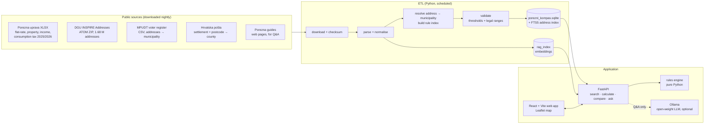

# PorezniKompas – Architecture

PorezniKompas tells private renters and holiday-home owners how much local tax
they pay for a given address in Croatia: the flat-rate income tax for renters
(*paušalni porez*, per bed / camp pitch / robinson unit) and the property tax
(*porez na nekretnine*, per m²). Every number comes from an official Porezna
uprava table; the app only finds the right row and multiplies.

Deadline: submission to open.data@mpudt.hr by **09.11.2026**.

---

## 1. Design principles

1. **Offline-first data.** All source data is downloaded by a scheduled job and
   compiled into one read-only database file. The app never calls data.gov.hr,
   DGU or Porezna at request time (data.gov.hr returns HTTP 502 under load).
2. **Deterministic numbers.** Tax amounts are computed by plain, unit-tested
   Python code. AI never produces an amount.
3. **Explainable results.** Every result carries its provenance: source
   dataset, year, table row, and which rule level matched (house-number range
   → street → settlement → municipality).
4. **Fail loudly in the pipeline, gracefully in the UI.** If a data refresh
   drops match rates below thresholds, the build fails and the old database
   stays live. If a single address is ambiguous, the user gets a choice.
5. **Small and boring stack.** One Python package, one SQLite file, one web
   frontend. Everything open source (required by the Pravila).

---

## 2. System overview



---

## 3. Technology choices

| Layer | Technology | Why |
|---|---|---|
| Language (backend, ETL) | **Python 3.12** (pin in Docker; 3.14 works locally for stdlib code, but some geo wheels lag) | Team knows it; all data scripts from the scan already exist in Python |
| Packaging | **uv** + `pyproject.toml` | Fast, lockfile, one command to set up |
| XLSX parsing | **python-calamine** (fallback: openpyxl) | Fast, handles the report-style Porezna files |
| GML parsing | streaming regex / **lxml.iterparse** over the ZIP | Address.gml is 2.6 GB uncompressed; must stream, never unpack |
| Coordinates | **pyproj** (EPSG:3035 → EPSG:4326) | DGU addresses are in LAEA Europe |
| Fuzzy matching | **rapidfuzz** | Street/settlement spelling variants (96 % of streets match, rest needs fuzzy) |
| Database (serving) | **SQLite** (read-only file) with **FTS5 trigram** index | One file, zero ops, sub-100 ms autocomplete over 1.68 M addresses |
| Exploration (optional) | DuckDB | Ad-hoc SQL over the raw CSV/XLSX while developing |
| API | **FastAPI** + **Pydantic v2** + **uvicorn** | Typed request/response models, automatic OpenAPI docs (useful for the jury: "interoperabilnost") |
| Frontend | **React 18 + Vite + TypeScript** | Fast dev loop, large ecosystem |
| UI components | **Tailwind CSS 4**, small hand-written components (`web/src/components`) | Few widgets needed; ARIA patterns (combobox, fieldsets) written directly, no component library to install |
| Data fetching | **TanStack Query** | Caching, debounced autocomplete |
| Map | **Leaflet** (react-leaflet) | Simple point map; base layers: OpenStreetMap tiles and **DGU orthophoto WMS** (another public dataset in the demo) |
| i18n | **react-i18next** (HR default, EN) | Many holiday-home owners are foreign |
| AI (optional feature) | **Ollama** with an open-weight model (e.g. Qwen2.5 7B Instruct) + **bge-m3** embeddings, vectors in **sqlite-vec** | Open source as required; runs locally; Croatian works acceptably |
| Testing | **pytest** (+ hypothesis for the rules engine), **Vitest**, **Playwright** for 2–3 end-to-end flows | Golden-address tests are the core quality proof |
| Lint / format | **ruff** (Python), **ESLint + Prettier** (TS) | |
| CI | **GitHub Actions**: lint + tests + frontend build on push; scheduled nightly ETL | |
| Deployment | **Docker Compose**: `api`, `web` (nginx serving static build + reverse proxy to API), `ollama` (optional), `etl` (cron / manual) | Runs identically on a laptop and on a small VPS for the demo link |
| Licence | **EUPL-1.2** | Recommended for public-sector reuse |

---

## 4. Repository layout

```
renter-tax-calculator/
├── pyproject.toml              # uv project: package "porezni_kompas"
├── src/porezni_kompas/
│   ├── etl/
│   │   ├── sources.py          # URLs, expected sizes, licences (single source of truth)
│   │   ├── download.py         # retries, checksums, raw cache
│   │   ├── parse_porezna.py    # 4 Porezna XLSX tables → typed records
│   │   ├── parse_dgu.py        # streaming GML → addresses
│   │   ├── parse_voters.py     # cp1250 ";" CSV → settlement → municipality
│   │   ├── parse_posta.py      # settlement + postcode → county
│   │   ├── normalize.py        # names, diacritics, hyphens, abbreviations
│   │   ├── resolve.py          # address → municipality, rule index
│   │   ├── validate.py         # thresholds, legal ranges, report
│   │   └── build.py            # writes porezni_kompas.sqlite atomically
│   ├── rules/
│   │   ├── pausal.py           # flat-rate rule matching + calculation
│   │   ├── property_tax.py     # m² × rate, ranges, exemption
│   │   └── models.py           # Pydantic result models with provenance
│   ├── api/
│   │   ├── main.py             # FastAPI app factory + routes
│   │   ├── models.py           # Pydantic request/response models
│   │   ├── search.py           # query parsing, FTS5 + re-ranking
│   │   ├── calculate.py        # rule selection at request time, provenance
│   │   ├── municipalities.py   # detail + neighbours (address centroids)
│   │   └── db.py               # read-only, immutable SQLite connection
│   └── rag/
│       ├── ingest.py           # Porezna guides → chunks → embeddings
│       └── answer.py           # retrieve + prompt + citations
├── tests/
│   ├── golden_addresses.csv    # ~50 hand-checked addresses with expected amounts
│   ├── test_rules_*.py
│   └── test_etl_*.py
├── web/                        # React + Vite app
├── data/
│   ├── raw/                    # downloaded sources (gitignored)
│   └── build/                  # porezni_kompas.sqlite (gitignored, published as release asset)
├── docker/
│   ├── api.Dockerfile
│   └── web.Dockerfile
├── docker-compose.yml
├── docs/
│   ├── ARCHITECTURE.md
│   ├── DATA_SOURCES.md         # every dataset, publisher, URL, licence (required by Pravila)
│   └── DATA_QUALITY.md         # defects found and how we handle them (jury material)
└── .github/workflows/ci.yml, etl.yml
```

---

## 5. Data sources

| Key | Dataset | Publisher | Format | Used for |
|---|---|---|---|---|
| `porezna_pausal` | Visina paušalnog poreza na dohodak po JLS za 2026. | Porezna uprava (data.gov.hr) | XLSX, 2-row header | flat-rate rules (1,442 rows) |
| `porezna_property` | Usporedba poreza na nekretnine 2025/2026 | Porezna uprava (data.gov.hr) | XLSX | property tax rates, who administers |
| `porezna_income` | Stope poreza na dohodak 2025 i 2026 | Porezna uprava (data.gov.hr, DataStore) | XLSX | context: income tax rates |
| `porezna_consumption` | Stope poreza na potrošnju 2026 | Porezna uprava (data.gov.hr) | XLSX | **official municipality codes** |
| `dgu_addresses` | Adrese INSPIRE | DGU (geoportal ATOM; data.gov.hr link empty) | ZIP of GML, EPSG:3035 | all 1,683,274 addresses + coordinates |
| `voters` | Registar birača – broj birača po adresi | MPUDT (data.gov.hr, DataStore) | CSV cp1250 `;` | settlement → municipality bridge |
| `posta` | Naselje i odredišni poštanski ured | Hrvatska pošta (data.gov.hr) | XLSX / XML | settlement + postcode → county |
| `guides` | Porezna uprava guides for renters / property tax | Porezna uprava web | HTML | Q&A corpus only |

All URLs live in `etl/sources.py` together with the expected row counts and
licence text, so `DATA_SOURCES.md` can be generated from code.

---

## 6. ETL pipeline

Runs as `uv run porezni-kompas-etl` (CLI) or the `etl` container. Target runtime
≈ 5 minutes.

1. **Download** each source with retries (exponential back-off; data.gov.hr
   502s are normal), store under `data/raw/<key>/<date>/`, record SHA-256,
   size, HTTP `Last-Modified`.
2. **Parse**
   - Porezna XLSX: locate the header row(s) explicitly (paušal has two header
     rows); map columns by name, not position; numbers with `,` decimals;
     property tax cells like `"5,20 do 6,50"` → `rate_min`, `rate_max`,
     `is_range = true`.
   - DGU GML: stream the ZIP member, extract per address: id, street, house
     number (+ letter suffix), settlement, postcode, x/y; resolve xlink
     components from `ThoroughfareName.gml`, `PostalDescriptor.gml`,
     `AdminUnitName.gml` (loaded into dicts first); transform to WGS84.
   - Voters CSV: decode cp1250, `;` delimiter → (county, municipality,
     settlement, street) set.
3. **Normalise** (`normalize.py`): uppercase, strip diacritics for matching
   keys (keep originals for display), unify hyphens (`BALE - VALLE` →
   `BALE-VALLE`), strip `GRAD`/`OPĆINA` prefixes, expand abbreviations
   (`DR.`, `SV.`, `UL.`).
4. **Resolve municipality for every address**
   1. (settlement, postcode) → county via Hrvatska pošta
   2. (county, settlement) → municipality via voter register
   3. else unique settlement name → municipality
   4. else mark `ambiguous` with candidate municipalities (≈1.55 %; the UI
      asks, or v2 resolves by point-in-polygon with municipality boundaries)
   Municipality identity = Porezna municipality code (from the consumption /
   property tables); a hand-maintained `municipality_aliases.csv` covers the
   known duplicates and spellings (Privlaka ×2, Sveta Nedelja ×2, Otok ×2,
   Tar-Vabriga, Kaštelir-Labinci).
5. **Build the rule index** – each paušal row becomes a rule with a
   *specificity level*: `house_range` > `street` > `settlement` >
   `municipality`, plus parity (even/odd) and unit type (bed / camp pitch /
   robinson).
6. **Validate** (build fails if any check fails):
   - row counts within ±5 % of the previous build
   - ≥ 98 % of addresses resolved to a municipality
   - ≥ 95 % of street-level rules match a street in the address data
   - every per-bed amount within the legal range of its category
     (I 100–300, II 70–200, III 30–150, IV/0 20–100 EUR)
   - all 556 municipalities have a property-tax entry
   Writes `validation_report.json`, which the UI shows on the "About the
   data" page.
7. **Publish**: write to `porezni_kompas.new.sqlite`, run `ANALYZE` and
   `VACUUM`, then atomically rename over the live file. The API reopens the
   file on the next request.

---

## 7. Database schema (SQLite)

```sql
municipality(
  id INTEGER PRIMARY KEY,            -- Porezna municipality code
  name TEXT, name_norm TEXT, county TEXT,
  tourism_category TEXT,             -- I, II, III, IV, 0
  property_tax_admin TEXT            -- 'PU' (Porezna uprava) or 'JLS'
);
settlement(id INTEGER PRIMARY KEY, name TEXT, name_norm TEXT,
           municipality_id INTEGER, county TEXT);
street(id INTEGER PRIMARY KEY, settlement_id INTEGER, name TEXT, name_norm TEXT);
address(
  id TEXT PRIMARY KEY,               -- DGU localId, e.g. KB.0000000135
  street_id INTEGER, settlement_id INTEGER,
  municipality_id INTEGER NULL,      -- NULL when ambiguous
  candidates TEXT NULL,              -- JSON list of municipality ids
  house_number TEXT, house_number_int INTEGER,
  postcode TEXT, lat REAL, lon REAL,
  label TEXT                         -- "Brežna ulica 33, Andraševec, 49243 Oroslavje"
);
-- Search runs over streets (~60k rows), not 1.68 M addresses: the user picks a
-- street, then the house number is matched in `address`. Small index, fast.
CREATE VIRTUAL TABLE street_fts USING fts5(label, content='street',
  content_rowid='id', tokenize='trigram remove_diacritics 1');

pausal_rule(
  id INTEGER PRIMARY KEY, year INTEGER, municipality_id INTEGER,
  settlement_norm TEXT NULL, street_norm TEXT NULL,
  house_from INTEGER NULL, house_to INTEGER NULL,
  parity TEXT NULL,                  -- 'even' | 'odd' | NULL
  rate_bed REAL, rate_camp_unit REAL, rate_robinson REAL,
  level TEXT,                        -- house_range | street | settlement | municipality
  source_row INTEGER                 -- row number in the official XLSX
);
property_tax(municipality_id INTEGER, year INTEGER,
             rate_min REAL, rate_max REAL, is_range INTEGER, raw_text TEXT);
income_tax(municipality_id INTEGER, year INTEGER, lower REAL, higher REAL);
legal_range(category TEXT PRIMARY KEY, min REAL, max REAL, default_amount REAL);
dataset_meta(key TEXT PRIMARY KEY, url TEXT, downloaded_at TEXT,
             sha256 TEXT, rows INTEGER, licence TEXT);
```

Expected size: ≈ 300–400 MB including the FTS index; ship it as a GitHub
release asset or rebuild with the ETL.

---

## 8. Rules engine

Pure functions, no I/O, fully unit-tested.

```python
def find_pausal_rule(address, rules) -> RuleMatch:
    # 1. house-number range on the same street (respect parity)
    # 2. street rule (settlement + street)
    # 3. settlement rule
    # 4. municipality rule
    # returns the rule + level + any warnings
```

Fallbacks and warnings (each becomes a visible note in the result):

| Situation | Behaviour |
|---|---|
| street listed for the municipality, but house number outside every range | show all candidate rules, ask user to confirm |
| municipality has only street/settlement rows and this one is missing | fall back to the closest settlement rule, warning "check with the municipality" |
| address ambiguous between municipalities | return candidates; UI asks once |
| property tax given as zone range | show min–max, explain zones |
| "permanent residence of the host" = yes | property tax 0 with explanation |

Calculation:

```
pausal = beds × rate_bed + camp_units × rate_camp_unit + robinson_units × rate_robinson
property_tax = area_m2 × rate   (or [area × min, area × max] for ranges)
```

Every result returns a `provenance` block: dataset key, year, XLSX row,
rule level, download date.

---

## 9. API (FastAPI)

| Method | Path | Purpose |
|---|---|---|
| GET | `/api/addresses/search?q=šercera 4 dubrovnik&limit=10` | autocomplete (FTS5 trigram + rapidfuzz re-ranking) |
| GET | `/api/addresses/{id}` | address detail incl. municipality / candidates |
| GET | `/api/streets/{id}/addresses` | house numbers of a street (after a street-only search) |
| POST | `/api/calculate` | body: `address_id`, `municipality_id?`, `beds`, `camp_units`, `robinson_units`, `area_m2`, `is_primary_residence` → amounts, ranges, warnings, provenance |
| GET | `/api/municipalities?q=` | municipality picker (ambiguous or unknown addresses) |
| GET | `/api/municipalities/{id}` | rates 2025 vs 2026, category, legal range, administered by |
| GET | `/api/municipalities/{id}/neighbours` | comparison with nearby municipalities |
| GET | `/api/meta/sources` | datasets, versions, validation report |
| POST | `/api/ask` | optional Q&A; returns answer + cited source links |

OpenAPI docs at `/api/docs` – mention them in the jury documentation
(interoperability criterion). No authentication; rate-limit with
`slowapi`. No user input is stored or logged beyond aggregate request counts.

---

## 10. Frontend

Pages:

1. **Calculator (home)** – address search box → map pin → form (beds, camp
   pitches, robinson units, m², "is this your permanent residence?") →
   result card: yearly flat-rate tax, property tax, change vs 2025, legal
   range bar for the category, "who sends the bill", warnings, "how we
   calculated this" (expandable provenance).
2. **Municipality page** – all rules for a municipality, including street
   lists (Dubrovnik etc.), neighbour comparison.
3. **Ask** – chat-style Q&A with source links (hidden if AI is disabled).
4. **About the data** – sources, update dates, validation report, known
   defects (doubles as jury material).

UX requirements: mobile-first, works on slow connections, WCAG 2.1 AA
(contrast, keyboard, screen-reader labels), Croatian default + English.

---

## 11. AI component (optional, behind a feature flag)

- **Scope:** answering questions about the rules ("Do I pay property tax if I
  live in the house and rent two rooms?"). Never amounts.
- **Pipeline:** Porezna guide pages → cleaned text → chunks (~500 tokens) →
  bge-m3 embeddings in sqlite-vec → top-k retrieval → Qwen2.5 7B Instruct
  via Ollama with a strict prompt: answer only from the given chunks, cite
  them, say "ne znam" otherwise.
- **Address helper (optional):** if FTS + fuzzy find nothing, the LLM
  rewrites a messy input ("ul dr a šercera 4 du") into a structured query.
- **Hardware:** 7B model needs ~8 GB RAM on CPU (slow) or a small GPU. For
  the demo server, either run a 3B model or disable the feature and show it
  in the video from a laptop.

---

## 12. Deployment

`docker-compose.yml`:

| Service | Image | Notes |
|---|---|---|
| `api` | python:3.12-slim + uv | mounts `data/build/porezni_kompas.sqlite` read-only |
| `web` | nginx:alpine | serves the Vite build, proxies `/api` to `api` |
| `ollama` | ollama/ollama | optional profile `ai` |
| `etl` | same image as `api` | run manually or by cron (`docker compose run etl`) |

Demo hosting: one small VPS (2 vCPU, 4–8 GB RAM) with Caddy for HTTPS, or the
API on a container host + the static frontend on GitHub Pages. The jury needs
a working link until results are published (17.11.2026).

---

## 13. Quality assurance

- **Golden addresses** (`tests/golden_addresses.csv`): ~50 addresses checked
  by hand against the Porezna XLSX, covering every rule level, Dubrovnik
  house-number ranges, even/odd streets, the duplicate-name municipalities,
  a zone-range property tax, and an ambiguous settlement. CI fails if any
  amount changes.
- **ETL validation** (section 6) on every build.
- **Property-based tests** for the rules engine (e.g. more beds never lowers
  the tax; a more specific rule always wins).
- **E2E** (Playwright): search → calculate → result for 3 addresses.

---

## 14. Plan to the deadline (09.11.2026)

| Days | Work |
|---|---|
| 28.10–29.10 | Repo skeleton, uv, ruff, CI; port scan scripts into `etl/` (Porezna, DGU, voters, pošta) |
| 30.10–31.10 | Normalisation, municipality resolution, rule index, validation, SQLite build |
| 01.11–02.11 | Rules engine + golden tests; FastAPI endpoints |
| 03.11–05.11 | Frontend: search, form, result card, map, municipality page |
| 06.11 | "About the data" page, i18n, accessibility pass |
| 07.11 | Optional RAG; Docker Compose; deploy demo |
| 08.11 | Docs (`DATA_SOURCES.md`, `DATA_QUALITY.md`), 3-minute video |
| 09.11 | Final check, submit |

Cut first if late: AI Q&A → neighbour comparison → English translation.

---

## 15. Known risks

| Risk | Mitigation |
|---|---|
| Porezna changes the XLSX layout | map columns by header name; validation fails loudly |
| data.gov.hr unavailable during the demo | app never depends on it at runtime |
| 1.55 % ambiguous addresses | ask the user; later point-in-polygon with municipality boundaries |
| Licence of some sources unclear | confirm with open.data@mpudt.hr; cite publisher + URL everywhere |
| Users read the result as an official decision | clear disclaimer + link to the municipality / Porezna |
