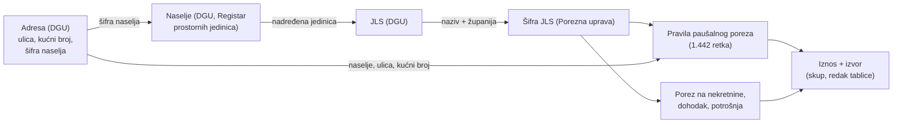
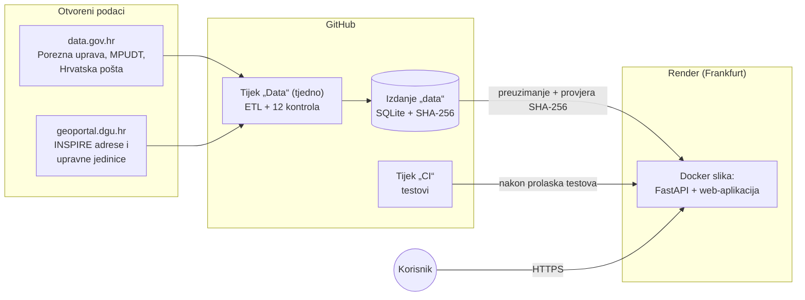

# PorezniKompas – tehnička i projektna dokumentacija

| | |
|---|---|
| **Natjecanje** | Datathon Portala otvorenih podataka 2026. |
| **Radni prototip** | https://porezni-kompas.onrender.com |
| **Otvoreni API** | https://porezni-kompas.onrender.com/api/docs |
| **Izvorni kod** | https://github.com/djurgec/renter-tax-calculator |
| **Licenca koda** | EUPL-1.2 (licenca besplatnog softvera otvorenog koda) |

---

## 1. Sažetak

PorezniKompas je web-aplikacija koja za **bilo koju adresu u Hrvatskoj** izračunava
godišnji **paušalni porez na dohodak od iznajmljivanja** (po krevetu, smještajnoj
jedinici u kampu i robinzonskoj jedinici) i **porez na nekretnine**. Uz svaki iznos
pokazuje iz kojeg skupa podataka i iz kojeg retka službene tablice dolazi.

Rješenje povezuje **osam skupova otvorenih podataka** četiriju izdavača (Porezna
uprava, Državna geodetska uprava, Ministarstvo pravosuđa, uprave i digitalne
transformacije, Hrvatska pošta). Svih **1.683.274 adrese** iz državnog registra adresa
povezuje sa službenim registrom prostornih jedinica, a zatim s pravilom iz porezne
tablice koje za tu adresu vrijedi: od raspona kućnih brojeva u ulici do stope za
cijelu općinu.

Podaci se ne mijenjaju niti se procjenjuju: aplikacija samo pronalazi pravi redak
službene tablice i množi. Kvalitetu svake izgradnje baze provjerava 12 automatskih
kontrola, a nova se baza objavljuje tek kad sve prođu.

## 2. Problem i ciljni korisnici

**Problem.** Svaka jedinica lokalne samouprave (JLS) svojom odlukom određuje visinu
paušalnog poreza po krevetu, a od 2025. godine unutar zakonskog raspona koji ovisi o
njezinoj kategoriji turističke razvijenosti. Mnoge određuju i različite iznose za
pojedina naselja, ulice, pa i za raspone kućnih brojeva (npr. Dubrovnik, Makarska). Porezna uprava te
odluke objavljuje kao tablicu na Portalu otvorenih podataka, ali:

- tablica ne sadrži šifre općina, pa se općine istog imena (dvije Privlake, dva Otoka,
  dvije Svete Nedelje) ne mogu razlikovati;
- pravila na razini ulica i kućnih brojeva građanin mora sam usporediti sa svojom
  adresom;
- porez na nekretnine i paušalni porez nalaze se u odvojenim tablicama, a uz njih treba
  znati i tko izdaje rješenje (Porezna uprava ili sama općina).

Iznajmljivač zato danas mora pronaći odluku svoje općine, ispravno je pročitati i sam
izračunati iznos.

**Ciljni korisnici.**

- **Privatni iznajmljivači** soba, apartmana i kuća za odmor (paušalisti), često bez
  porezne naobrazbe, koji iznos provjeravaju jednom ili dvaput godišnje, često na
  mobitelu.
- **Vlasnici kuća za odmor**, uključujući strane državljane (aplikacija ima i
  engleski jezik).
- **Knjigovođe, turističke zajednice i općinske službe** koji odgovaraju na upite
  iznajmljivača.
- **Budući iznajmljivači** koji uspoređuju porezno opterećenje u susjednim općinama.

**Korisnička vrijednost.** Jedan pouzdan iznos za točnu adresu u manje od minute,
objašnjenje odakle dolazi i usporedba sa susjednim općinama, bez traženja odluka i
čitanja tablica.

**Relevantnost za izazove Datathona.** Rješenje odgovara ciljevima izazova
**A – Društvo i javne usluge** (bolji pristup javnim informacijama, lokacijski
utemeljena informacijska usluga za građane, predstavljanje javnih podataka građanima) i
izazova **C – Gospodarstvo i učinkovito upravljanje** (povezivanje lokalnih,
prostornih i administrativnih podataka, smanjenje vremena i troška pronalaženja
informacija, manje administrativno opterećenje).

## 3. Funkcionalnosti

- **Pretraživanje adresa** za cijelu Hrvatsku, otporno na dijakritičke znakove i
  skraćenice (npr. „sercera 4 dubrovnik“), s odabirom kućnog broja kad je upisana samo
  ulica.
- **Izračun** paušalnog poreza (kreveti, jedinice u kampu, robinzonske jedinice) i
  poreza na nekretnine (korisna površina u m²), uz oslobođenje za nekretninu u kojoj
  vlasnik ima prebivalište.
- **Objašnjenje izračuna:** razina pravila koje se primjenjuje (raspon kućnih brojeva,
  ulica, naselje ili cijela općina), zakonski raspon za kategoriju turističke
  razvijenosti s položajem stope općine, tko izdaje rješenje, usporedba s prethodnom
  godinom, napomene i izvori s brojem retka u službenoj tablici.
- **Karta** s paušalnom stopom svih 556 općina i gradova te usporedba sa susjednim
  općinama.
- **Stranica svake općine** sa svim pravilima paušalnog poreza i stopama poreza na
  nekretnine, dohodak i potrošnju za 2025. i 2026.
- **Stranica „O podacima“** s izvorima, datumima preuzimanja i rezultatima kontrola
  kvalitete posljednje izgradnje baze.
- **Dijeljenje izračuna** poveznicom (svi unosi su u adresi stranice).
- **Hrvatski i engleski jezik**, prilagodba mobitelu, tamni način rada, upravljanje
  tipkovnicom i oznake za čitače zaslona.
- **Otvoreni REST API** sa svim navedenim funkcijama (poglavlje 8).

## 4. Korišteni skupovi podataka

Svi skupovi su otvoreni podaci javnog sektora. Prednost je dana podacima s Portala
otvorenih podataka (data.gov.hr).

| # | Skup podataka | Izdavač | Poveznica | Format | Dozvola | Uporaba u rješenju |
|---|---|---|---|---|---|---|
| 1 | Usporedba poreznih stopa prema odlukama JLS – *Visina paušalnog poreza na dohodak po JLS za 2026.* | Porezna uprava | [data.gov.hr](https://data.gov.hr/ckan/dataset/3c19c044-4cc4-42f1-ac97-29286a2bf305) | XLSX | Otvorena dozvola | 1.442 pravila paušalnog poreza (općina, naselje, ulica, raspon kućnih brojeva) |
| 2 | isti skup – *Usporedba poreza na nekretnine 2025./2026.* | Porezna uprava | isto | XLSX | Otvorena dozvola | stope poreza na nekretnine, tko izdaje rješenje, popis 556 JLS |
| 3 | isti skup – *Stope poreza na dohodak 2025. i 2026.* | Porezna uprava | isto | XLSX | Otvorena dozvola | stope poreza na dohodak (stranica općine) |
| 4 | isti skup – *Visina stopa poreza na potrošnju za 2026.* | Porezna uprava | isto | XLSX | Otvorena dozvola | službene šifre JLS, porez na potrošnju |
| 5 | Adrese INSPIRE | Državna geodetska uprava | [data.gov.hr](https://data.gov.hr/ckan/dataset/adrese-inspire) · [preuzimanje](https://geoportal.dgu.hr/services/atom/INSPIRE_Addresses_(AD).zip) | GML u ZIP-u, EPSG:3035 | Otvorena dozvola | svih 1.683.274 adresa: ulica, kućni broj, naselje, poštanski broj, koordinate |
| 6 | Upravne jedinice INSPIRE | Državna geodetska uprava | [data.gov.hr](https://data.gov.hr/ckan/dataset/upravne-jedinice-inspire) · [preuzimanje](https://geoportal.dgu.hr/services/atom/INSPIRE_Administrative_Units_(AU).zip) | GML u ZIP-u | Otvorena dozvola | službena hijerarhija županija → JLS → naselje (6.759 naselja); povezuje svaku adresu s općinom |
| 7 | Registar birača – broj birača po adresi | Ministarstvo pravosuđa, uprave i digitalne transformacije | [data.gov.hr](https://data.gov.hr/ckan/dataset/a4f06d5d-52bd-46b5-a4e7-cf01d4f6e227) | CSV | Otvorena dozvola | županija svake JLS; neovisna provjera povezivanja adresa (koriste se samo nazivi mjesta, ne broj birača) |
| 8 | Naselje i odredišni poštanski ured | Hrvatska pošta d.d. | [data.gov.hr](https://data.gov.hr/ckan/dataset/naselje-i-odredisni-postanski-ured) · [preuzimanje](https://www.posta.hr/mjestaRh.aspx) | XLSX | nije navedena | samo neovisna provjera povezivanja adresa |

Uz to, obris Hrvatske na karti izveden je iz skupa **Natural Earth** (javno dobro,
naturalearthdata.com).

Točne poveznice za preuzimanje, očekivane veličine i SHA-256 sažetak svake datoteke
nalaze se u kodu (`src/porezni_kompas/etl/sources.py`) i u aplikaciji (stranica
„O podacima“ i API `/api/meta/sources`).

## 5. Povezivanje podataka

Glavna vrijednost rješenja je povezivanje skupova koji zasebno ne odgovaraju na
pitanje „koliko plaćam za ovu adresu“.

**Koraci:**

1. **Adresa → naselje.** Svaka adresa u registru adresa DGU-a nosi šifru naselja
   (matični broj naselja).
2. **Naselje → općina.** Registar prostornih jedinica (Upravne jedinice INSPIRE) za
   svako od 6.759 naselja daje općinu ili grad kojemu pripada. Time je **100 % adresa**
   povezano s općinom, bez pogađanja po nazivima.
3. **Općina → porezne tablice.** Općine iz registra povezuju se sa šiframa iz tablica
   Porezne uprave po nazivu unutar iste županije. To razlikuje općine istog imena
   (Otok u Splitsko-dalmatinskoj i Vukovarsko-srijemskoj županiji). Povezano je svih
   556 JLS.
4. **Adresa → pravilo.** Za svaku adresu bira se najuže primjenjivo pravilo: raspon
   kućnih brojeva u ulici (uz parnu ili neparnu stranu), zatim ulica, naselje i na kraju
   cijela općina. Nazivi ulica iz porezne tablice uspoređuju se s registrom adresa i
   točno i približno (za razlike u pisanju): pronađeno je 446 od 461 ulice navedene u
   tablici.
5. **Neovisna provjera.** Povezivanje adresa s općinama provjerava se i drugim putem
   (poštanski broj i naselje → županija prema Hrvatskoj pošti → općina prema registru
   birača). Oba se puta podudaraju za **99,99 %** adresa koje oba povezuju. Ta provjera
   otkrila je 164 adrese koje bi se samo po nazivima pogrešno povezale (npr. naselje
   Tisovac postoji u više općina), te 26.143 adrese koje se po nazivima ne bi mogle
   jednoznačno povezati.

**Rezultat (izgradnja od 1. 11. 2026.):**

| Razina pravila koje se primjenjuje | Broj adresa |
|---|---|
| cijela općina | 1.499.920 |
| naselje | 174.656 |
| ulica | 7.044 |
| raspon kućnih brojeva | 793 |
| bez pravila u tablici (poglavlje 11) | 861 |

### Kontrole kvalitete

Svaka izgradnja baze prolazi 12 automatskih kontrola. Ako ijedna ne prođe, nova se baza
ne objavljuje i ostaje prethodna.

| Kontrola | Uvjet |
|---|---|
| broj adresa | najmanje 1.600.000 |
| adrese povezane s općinom | najmanje 99,9 % (trenutačno 100 %) |
| ulice iz porezne tablice pronađene u registru adresa | najmanje 95 % (trenutačno 96,7 %) |
| registar prostornih jedinica povezan s poreznim tablicama | svih 556 JLS, svako naselje ima općinu |
| registar i provjera po nazivima daju istu općinu | najmanje 99,9 % (trenutačno 99,99 %) |
| sve JLS na popisu | 556 |
| svaka JLS ima županiju | bez iznimaka |
| svaka JLS ima stopu poreza na nekretnine | 556 |
| svaka JLS ima paušalni porez | najmanje 550 (trenutačno 556) |
| iznosi po krevetu unutar zakonskog raspona kategorije | I. 100–300 €, II. 70–200 €, III. 30–150 €, IV. i 0 20–100 € |
| koordinate svih adresa unutar Hrvatske | bez iznimaka |
| svaki redak paušalne tablice dodijeljen općini | bez iznimaka |

### Nejednoznačni retci službene tablice

Tablica paušalnog poreza za tri para općina istog imena ne navodi o kojoj je riječ.
Retci su dodijeljeni na temelju objavljenih odluka općina, a preostali redak svakog para
isključivanjem. Svaka dodjela s izvorom zapisana je u
`data/reference/pausal_municipality_overrides.csv`.

| Retci | Dodjela | Izvor |
|---|---|---|
| 1015 (20 €) / 1016 (60 €) | Općina Otok (Splitsko-dalmatinska) / Grad Otok (Vukovarsko-srijemska) | Odluka Općine Otok, KLASA 410-03/25-01/01, 27. 11. 2025., primjena od 1. 1. 2026. |
| 1272 (50 €) / 1271 (30 €) | Općina Sveta Nedelja (Istarska) / Grad Sveta Nedelja (Zagrebačka) | Odluka Općine Sveta Nedelja, KLASA 024-02/25-01/002, 24. 2. 2025. |
| 1077 (70 €) / 1078 (60 €) | Privlaka (Zadarska) / Privlaka (Vukovarsko-srijemska) | odluka Općine Privlaka (Zadarska) |

## 6. Tehnička arhitektura

### Komponente

**1. Priprema podataka (ETL, Python).** Preuzima izvore uz ponovne pokušaje i provjeru
veličine te bilježi SHA-256 sažetak svake datoteke. Nakon toga:

- čita tablice Porezne uprave i ispravno tumači dvoretčana zaglavlja, decimalne zareze
  i raspone stopa (npr. „5,20 do 6,50“);
- čita GML datoteke DGU-a izravno iz ZIP arhive, bez raspakiravanja (registar adresa
  ima 2,6 GB, a registar upravnih jedinica 600 MB);
- pretvara koordinate iz europskog sustava EPSG:3035 u WGS84 (EPSG:4326);
- povezuje podatke (poglavlje 5) i pokreće kontrole kvalitete;
- zapisuje jednu SQLite bazu (≈178 MB) s indeksom za pretraživanje (FTS5, trigrami bez
  dijakritika) i objavljuje je atomarnom zamjenom datoteke.

Cijeli postupak traje oko 5 minuta.

**2. Baza podataka (SQLite, samo za čitanje).** Jedna datoteka s općinama, pravilima,
stopama, 52.454 ulice, 1.683.274 adrese i podacima o izvorima. Nema poslužitelja baze
koji bi trebalo održavati, a aplikacija se pri radu ne oslanja na vanjske servise, pa
radi i kad je neki izvor nedostupan.

**3. API (Python, FastAPI).** Pretraživanje adresa, izračun, podaci o općinama, karta i
metapodaci o izvorima. Pravila i izračun su obične, testovima pokrivene funkcije: iznos
se nikad ne procjenjuje, nego se uzima iz službenog retka i množi. Svaki odgovor
izračuna sadrži izvore s brojem retka. API ograničava broj zahtjeva po korisniku
(300 u minuti).

**4. Web-aplikacija (TypeScript, React).** Kalkulator, karta, stranice općina i
stranica o podacima. U produkciji je poslužuje isti proces kao i API, na istoj adresi.

**5. Isporuka (GitHub Actions, Docker, Render).**

- Tijek **CI** pri svakoj promjeni pokreće provjeru koda, testove i izgradnju
  web-aplikacije.
- Tijek **Data** jednom tjedno (ili na zahtjev) gradi bazu iz izvora i objavljuje je
  kao izdanje `data`, ali samo ako sve kontrole prođu.
- Docker slika preuzima tu bazu i provjerava joj SHA-256 sažetak; neispravna datoteka
  zaustavlja izgradnju, pa ostaje raditi prethodna inačica.
- Render pokreće sliku u regiji Frankfurt (EU).

### Načela

1. **Podaci se pripremaju unaprijed.** Aplikacija pri radu ne poziva izvorne servise.
2. **Iznosi su deterministički.** Ni jedan iznos ne nastaje procjenom ni umjetnom
   inteligencijom.
3. **Svaki rezultat je objašnjiv.** Uz iznos se navodi izvor, godina, redak tablice i
   razina pravila.
4. **Greške se otkrivaju pri izgradnji, a ne kod korisnika.** Neispravni podaci
   zaustavljaju objavu.
5. **Mala i jednostavna arhitektura.** Jedan proces, jedna datoteka baze, sve otvorenog
   koda.

## 7. Standardi i interoperabilnost

- **INSPIRE** podatkovne teme Adrese (AD) i Upravne jedinice (AU), u formatu **GML 3.2**
  kakav vraća WFS 2.0.
- Koordinatni sustavi **EPSG:3035** (izvor) i **EPSG:4326 / WGS84** (aplikacija).
- **Službeni identifikatori:** šifre JLS Porezne uprave, matični brojevi naselja iz
  Registra prostornih jedinica i lokalni identifikatori adresa DGU-a. Svaki rezultat
  nosi te ključeve, pa se može povezati s drugim javnim registrima.
- **REST API s opisom OpenAPI 3** (interaktivna dokumentacija na `/api/docs`, strojno
  čitljiv opis na `/api/openapi.json`), odgovori u **JSON-u** (UTF-8).
- Izvorni formati s Portala otvorenih podataka: XLSX, CSV, XML.
- Cjelovitost podataka: **SHA-256** sažeci za sve izvore i za objavljenu bazu.
- Sučelje je izrađeno s obzirom na smjernice pristupačnosti **WCAG 2.1** (semantička
  struktura, oznake za čitače zaslona, upravljanje tipkovnicom); formalna provjera
  sukladnosti nije provedena.
- Isporuka u **OCI/Docker** spremniku: rješenje se može pokrenuti na bilo kojoj
  infrastrukturi koja podržava spremnike.

## 8. Integracijski potencijal

API je javan i opisan standardom OpenAPI, pa se rješenje uz male prilagodbe može
povezati s postojećim sustavima:

| Tko | Kako |
|---|---|
| **Porezna uprava** | povezivanje adresa sa stopama za provjeru ili predlaganje iznosa pri izdavanju rješenja te za odgovore na upite poreznih obveznika |
| **Jedinice lokalne samouprave** | poveznica ili ugrađeni kalkulator na stranicama općine za njezine odluke; stranica općine u aplikaciji ima stalnu adresu (`/opcine/{šifra}`) |
| **Turističke zajednice i udruge iznajmljivača** | informiranje članova; usporedba sa susjednim općinama |
| **Knjigovodstveni programi i programi za upravljanje smještajem** | automatski izračun obveze za objekt po adresi (`POST /api/calculate`) |
| **Portal otvorenih podataka** | objava izvedenog skupa „adresa → JLS → pravilo paušalnog poreza“ kao novog otvorenog skupa podataka |

API endpointi: `/api/addresses/search`, `/api/addresses/{id}`,
`/api/streets/{id}/addresses`, `/api/calculate`, `/api/municipalities`,
`/api/municipalities/{šifra}`, `/api/municipalities/{šifra}/neighbours`, `/api/map`,
`/api/meta/sources`, `/api/health`.

## 9. Preduvjeti

### Tehnički

- poslužitelj ili usluga za spremnike (Docker) s najmanje 512 MB radne memorije, bez
  zasebnog poslužitelja baze; aplikacija pri radu troši oko 50 MB memorije;
- za osvježavanje podataka odlazni HTTPS pristup prema data.gov.hr, geoportal.dgu.hr i
  posta.hr (oko 390 MB po izgradnji) te planer zadataka (sada GitHub Actions);
- za pokretanje bez interneta dovoljna je jedna datoteka baze (≈178 MB).

### Organizacijski

- osoba ili tim koji održava rješenje: prati tjedni izvještaj kontrola kvalitete i
  reagira kad izgradnja ne prođe;
- godišnje ažuriranje poveznica na nove tablice kad Porezna uprava objavi stope za novu
  godinu;
- vođenje evidencije dodjela nejednoznačnih redaka (s izvorom u odluci općine) te
  provjera praznina u tablici s općinama (poglavlje 11);
- kanal za prijave korisnika; poželjna je suradnja s Poreznom upravom kao izdavačem
  podataka.

### Pravni

- **Dozvole za podatke:** sedam od osam skupova objavljeno je pod Otvorenom dozvolom,
  koja dopušta ponovnu uporabu uz navođenje izvora; izvori su navedeni u aplikaciji i u
  ovoj dokumentaciji. Skup Hrvatske pošte na portalu nema navedenu dozvolu, a koristi
  se samo za neovisnu provjeru, pa se bez utjecaja na rezultate može izostaviti dok se
  dozvola ne potvrdi.
- **Informativni karakter:** izračun ne zamjenjuje rješenje poreznog tijela, što
  aplikacija jasno navodi uz svaki rezultat.
- **Osobni podaci:** rješenje ne obrađuje osobne podatke. Nema korisničkih računa, a
  unosi korisnika ne spremaju se u bazu; poslužitelj vodi samo uobičajene tehničke
  zapise pristupa. Odabir jezika pamti se samo u pregledniku korisnika, a izračun se
  dijeli isključivo poveznicom koju korisnik sam kopira. Iz registra birača
  koriste se samo nazivi županija, općina, naselja i ulica, ne broj birača.
- **Licenca koda:** EUPL-1.2, licenca koju preporučuje Europska unija za softver javnog
  sektora; dopušta slobodnu ponovnu uporabu i prilagodbu.

## 10. Kvaliteta i testiranje

- **69 automatskih testova** u Pythonu: normalizacija naziva, odabir pravila, izračun,
  API, registar prostornih jedinica, postavke za isporuku i provjere nad stvarnom
  bazom. Za 3.000 adresa provjerava se da API odabire isto pravilo kao i priprema
  podataka; zasebno se provjeravaju i općine istog imena.
- **30 testova u pregledniku** (Playwright, 15 scenarija na računalu i mobitelu):
  pretraživanje, izračun, odabir kućnog broja, oslobođenje od poreza na nekretnine,
  dijeljenje poveznice, karta, promjena jezika.
- **12 kontrola kvalitete** pri svakoj izgradnji baze (poglavlje 5).
- Svi testovi pokreću se automatski pri svakoj promjeni koda (GitHub Actions).
- **Mjerenja** u istim ograničenjima koja ima besplatni Render poslužitelj (512 MB,
  oko 0,1 procesora): većina zahtjeva traje 0,1–0,2 s, a pokretanje oko 17 s.

## 11. Ograničenja

- **Praznine u službenoj tablici:**
  - za 773 adrese u Općini Grožnjan i 88 u Dubrovniku tablica ne navodi stopu jer su
    navedena samo neka naselja ili ulice; aplikacija to jasno kaže korisniku;
  - 391 adresa (većinom u Makarskoj) ima kućni broj izvan svih navedenih raspona, pa
    se primjenjuje opća stopa uz napomenu;
  - 6 adresa ulazi u dva raspona od kojih je jedan naveden s 0 €; prikazuju se oba
    iznosa.
- **Nazivi ulica:** 15 naziva ulica iz tablice za Dubrovnik (skraćenice, parkovi)
  nije pronađeno u registru adresa.
- **Zone poreza na nekretnine:** 53 općine imaju više zona, a zone nisu objavljene kao
  otvoreni podaci, pa se iznos prikazuje kao raspon.
- **Oslobođenja:** od oslobođenja od poreza na nekretnine obuhvaćeno je samo stalno
  stanovanje vlasnika.
- **Besplatni poslužitelj:** nakon 15 minuta bez posjeta „spava“, pa prvo učitavanje
  traje oko minutu; pretraga jedne vrlo česte riječi (npr. „ulica“) traje oko 2 s.

### Preporuke izdavačima podataka

- **Porezna uprava:** u tablicu paušalnog poreza dodati šifru JLS (uklonila bi
  nejednoznačnost općina istog imena), nazive ulica pisati kao u registru adresa,
  pojasniti značenje redaka s iznosom 0 € te objaviti zone poreza na nekretnine.
- **Državna geodetska uprava:** na data.gov.hr popuniti poveznice za preuzimanje (ATOM)
  skupova „Adrese INSPIRE“ i „Upravne jedinice INSPIRE“, koje su sada prazne.
- **Hrvatska pošta:** navesti dozvolu za skup „Naselje i odredišni poštanski ured“.
- **MPUDT:** objavljivati registar birača pod stalnom poveznicom (naziv datoteke sada
  sadrži datum).

## 12. Mogućnosti daljnjeg razvoja

- **Karta s granicama općina:** granice su već u registru upravnih jedinica koji
  rješenje koristi.
- **Automatsko pronalaženje novih tablica** preko API-ja Portala otvorenih podataka
  (CKAN), bez ručnog ažuriranja poveznica svake godine.
- **Popunjavanje praznina** u suradnji s općinama (Grožnjan, Makarska, Dubrovnik) i
  popis zamjenskih naziva ulica.
- **Zone poreza na nekretnine** kad ih općine objave kao otvorene podatke.
- **Obavijesti iznajmljivačima** kad njihova općina promijeni stopu.
- **Ugradivi kalkulator (widget)** za stranice općina i turističkih zajednica.
- **Asistent za pitanja** o pravilima oporezivanja temeljen na umjetnoj inteligenciji,
  uz citiranje službenih vodiča Porezne uprave; iznose bi i dalje računao samo
  deterministički dio.
- **Objava izvedenog skupa** adresa i primjenjivih pravila na Portalu otvorenih
  podataka.

## 13. Korišteni alati i biblioteke

Sav softver od kojeg je rješenje izgrađeno je otvorenog koda; za automatizaciju i
smještaj koriste se usluge GitHub i Render.

| Područje | Alati (licenca) |
|---|---|
| Priprema podataka i API | Python 3.12 (PSF), FastAPI (MIT), Pydantic (MIT), Uvicorn (BSD), httpx (BSD), python-calamine (MIT), pyproj (MIT) i PROJ (MIT), RapidFuzz (MIT), SQLite s FTS5 (javno dobro), uv (MIT/Apache 2.0) |
| Web-aplikacija | TypeScript (Apache 2.0), React (MIT), React Router (MIT), TanStack Query (MIT), i18next i react-i18next (MIT), Tailwind CSS (MIT), Vite (MIT), fontovi Barlow i Spectral (SIL Open Font License) preko Fontsource (MIT) |
| Kvaliteta | pytest (MIT), Ruff (MIT), Playwright (Apache 2.0), oxlint (MIT) |
| Isporuka | Docker Engine (Apache 2.0); usluge GitHub Actions i Render |
| Kartografska podloga | Natural Earth (javno dobro) |

**Alati temeljeni na umjetnoj inteligenciji.** U razvoju je korišten **Claude Code**
(Anthropic) kao asistent pri programiranju, analizi kvalitete podataka i pisanju
dokumentacije. Za oblikovanje korisničkog sučelja korištena su njegova proširenja
otvorenog koda, uključena u repozitorij s izvornim licencama:

- **impeccable** (Apache 2.0)
- **taste-skill** (MIT)
- **emil-design-eng** (MIT)

Proširenja se automatski provjeravaju alatom **NVIDIA SkillSpector** pri svakoj
promjeni i jednom tjedno, uz proširenje **skill-inspector** (Apache 2.0).

Sama aplikacija pri radu ne koristi umjetnu inteligenciju: svi iznosi računaju se
determinističkim kodom iz službenih tablica i provjereni su automatskim testovima.

## 14. Pokretanje

- **Radni prototip:** https://porezni-kompas.onrender.com
- **Lokalno, uz Docker:** `docker compose up --build`, a zatim http://localhost:8000
- **Izgradnja baze iz izvora:** `docker compose run --rm etl`

Detaljne upute nalaze se u datoteci `README.md` u korijenu repozitorija.
